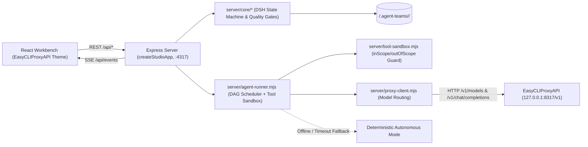
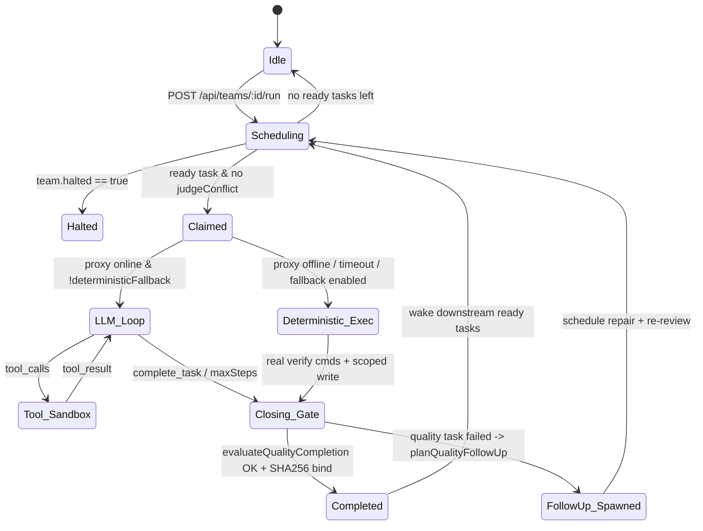

# AgentTeams Studio — 系统架构与接口契约规格说明书（ARCHITECTURE_SPEC）

> **团队**：`agent-teams-studio` | **任务**：`t1` | **架构师**：`arch-planner`  
> **工作区**：`.`  
> **基准资产**：EasyCLIProxyAPI CSS Token / Sidebar / Surfaces 规范、DSH AgentTeams Core（`server/lib/`）、V2 鲸鱼娘视觉资产、本地 EasyCLIProxyAPI 网关（`http://127.0.0.1:8317/v1`）

---

## 1. 系统总览与设计目标

**AgentTeams Studio** 是一款可完全脱离 Antigravity 宿主独立运行的 **Multi-Agent 全栈协同工作台软件**（Express + SSE 后端引擎 + Vite/React 前端 + CLI 一键启动器）。用户无需回到宿主对话即可在浏览器内完成：

1. **目标建队与草案审批**：支持 Easy Mode 目标推荐、三套内置预设（`chatgpt-crew`、`heterogeneous-cross-review`、`ai-radar-squad`）及自定义契约构造器，遵循 `staged -> approve -> running -> archive` 生命周期。
2. **实时可视化进度与全闭环操控**：内置全局百分比进度条、五阶段流水线步骤条、分层 DAG 拓扑图与任务呼吸脉冲/耗时计时器、V2 鲸鱼娘成员卡片、SSE 实时活动控制台与持久信箱。
3. **直连 EasyCLIProxyAPI 驱动自主完成任务**：对接 `http://127.0.0.1:8317/v1` 拉取在线 `/v1/models`、自动完成预设模型到在线模型的智能路由映射，并为队员挂载受 `inScope` / `outOfScope` 沙箱保护的文件读写、目录检索、命令执行、信箱通信与质量门交卷工具。
4. **零妥协 P0 质量门与防自审红线**：严格复用 DSH AgentTeams 核心状态机与质量门，强制执行 N-1 防自审（`judgeConflictFor`）、SHA256 产物绑定（`bindClosingVerdict`）、产物漂移审计（`auditTeamWorkspace`）与自动返修循环（`planQualityFollowUp`）。



---

## 2. 边界范围（Scope & Guardrails）

### 2.1 `inScope`（架构与后续实现边界）

- `package.json`, `tsconfig.json`, `vite.config.ts`, `index.html`, `README.md`
- `bin/agent-teams-studio.mjs`（CLI 启动入口）
- `server/`（Express + SSE 服务、DSH 核心库复制至 `server/core/`、代理客户端、工具沙箱、自主执行引擎、设置存储、工作区浏览）
- `src/`（EasyCLIProxyAPI 风格 4 套主题 Token、Quiet Sidebar、6 大全闭环页面、实时进度 GUI、V2 鲸鱼娘卡片、DAG 拓扑与抽屉）
- `tests/studio.test.mjs`（端到端 API、质量门、防自审、沙箱、确定性执行与隔离测试）
- 状态持久化根目录严格限定为 `<workspace>/.agent-teams/`

### 2.2 `outOfScope`（严禁越界项）

- `.env`、`secrets/`、`id_rsa*` 等敏感凭证文件（沙箱与产物审计默认拒绝对外暴露或篡改）
- `%APPDATA%/Roaming` 或任何工作区外宿主私有状态目录（`XR-03` 硬红线：禁止状态逃逸）
- 测试用例禁止读写主工作区 `.agent-teams/`（详见第 7 节测试隔离约束）
- 不依赖 Antigravity / DSH 宿主进程运行期注入（完全独立 Node.js + 浏览器运行）

---

## 3. EasyCLIProxyAPI 风格 UI 拓扑 & 实时可视化进度 GUI

### 3.1 左侧安静导航栏（Quiet Sidebar）

严格复刻 `EasyCLIProxyAPI-repo/src/styles/sidebar.css` 视觉准则：

| 规范项 | 精确约束（源自 `sidebar.css`） |
| :--- | :--- |
| 外壳布局 | `.sidebar { position: sticky; top: 0; height: 100vh; padding: 16px 12px 12px; border-right: 1px solid var(--sidebar-edge); background: var(--sidebar-bg); }` |
| 垂直基准轴 | 12px 外边距 + 10px 行内边距；Brand Logo (`32x32`, `--radius-md`, `--sidebar-logo-ring`)、导航图标与底部工具图标严格左对齐 |
| 导航行样式 | `.nav-section button`：`height: 34px; padding: 0 10px; gap: 10px; border: 0; border-radius: var(--radius-md); background: transparent;` 无边框行 |
| 静默交互反馈 | Hover 仅变化 `background: var(--sidebar-hover-bg)` 与文字色调，**禁止位移动画**；`:active` 按压态 `background: var(--sidebar-press-bg); transition-duration: 0ms;`（即时按压反馈） |
| 选中态标识 | `.active` 使用 `background: var(--sidebar-selected-bg); box-shadow: var(--sidebar-selected-shadow);` + 左侧 `::before` 胶囊竖条（`width: 3px; height: 16px; border-radius: var(--radius-full); background: var(--ui-accent)`） |
| 三档响应式 | `>1100px` 完整侧边栏（默认宽 `240px`）；`901px..1100px` 收窄为 `64px` 图标 Rail（文字视觉隐藏保留无障碍树+Tooltip）；`<=900px` 转为顶部双行横栏 |
| 底部工具区 | `.sidebar-bottom` / `.sidebar-utility`：主题切换器（`light` / `dark` / `sakura` / `midnight`）、网关连通脉冲指示点（`.nav-update-indicator`）、工作区路径显示与隐私遮罩开关 |

### 3.2 四套主题 CSS Token 规范

根元素通过 `data-theme="light|dark"` 与 `data-theme-id="light|dark|sakura-light|midnight-dark"` 切换完整语义 Token（严格对齐 `semantic.css` + `themes/{light,dark,sakura,midnight}.ts`）：

| Token 变量 | `light`（默认白昼） | `dark`（深邃暗夜） | `sakura`（樱语红粉） | `midnight`（午夜蓝） |
| :--- | :--- | :--- | :--- | :--- |
| `--color-workspace` | `#ffffff` | `#0b0d11` | `#FDE8EF`（叠加 `#FFE1F0 -> #FAF5EE` 120° 渐变） | `#101827`（叠加 `#101827 -> #202841` 135° 渐变） |
| `--color-surface` / `--bg-card` | `#ffffff` | `#141720` | `#FFF8F8` | `#1C263B` |
| `--color-surface-subtle` | `#eff3f0` | `#1c212c` | `#F8EDF1` | `#243049` |
| `--color-surface-hover` | `#f6f8f6` | `#252b38` | `#F1E1E9` | `#2D3954` |
| `--color-text-primary` | `#0f172a` | `#f8fafc` | `#2D282C` | `#E6EAF2` |
| `--color-text-secondary` | `#1e293b` | `#d3dce8` | `#544D53` | `#CDD5E5` |
| `--color-text-muted` | `#475569` | `#9aa9bf` | `#6B6269` | `#ADB9CF` |
| `--color-border-default` | `#e2e8f0` | `#222836` | `#66505D18` | `#B1BDEA2E` |
| `--ui-accent` | `#222222` | `#f5f5f5` | `#984D75` | `#A5B4FC` |
| `--ui-accent-strong` | `#000000` | `#ffffff` | `#843E64` | `#C2CCFF` |
| `--ui-accent-soft` | `#f0f0f0` | `rgba(245,245,245,0.12)` | `#F6E3ED` | `#2B3552` |
| `--sidebar-bg` | `#f7f8fa` | `#0f1218` | `#FEE4EF` | `#111A2B` |
| `--sidebar-selected-bg` | `#ffffff` | `rgba(255,255,255,0.075)` | `#EAD2DE` | `#2C3753` |
| `--color-success` | `#2f6b3f` | `#34d399` | `#2f6b3f` | `#34d399` |
| `--color-warning` | `#c77b30` | `#d97706` | `#c77b30` | `#fbbf24` |
| `--color-danger` | `#9f2d20` | `#c65746` | `#9f2d20` | `#f87171` |
| `--color-info` | `#0f766e` | `#60a5fa` | `#984D75` | `#A5B4FC` |

### 3.3 表面体系（`.surface-panel` / `.surface-card`）

对齐 `EasyCLIProxyAPI-repo/src/styles/surfaces.css`：

- `.surface-panel`：`border: 1px solid var(--border-color); border-radius: var(--radius-lg) [12px]; background: var(--bg-card); box-shadow: var(--ui-panel-shadow);`，hover 时边框收敛至 `--border-primary`。用于主工作区容器、DAG 画布外壳、控制台卡片。
- `.surface-card`：`border: 1px solid var(--border-color); border-radius: var(--radius-lg) [12px]; background: var(--bg-card); box-shadow: none;`。用于成员卡片、预设卡片、质量门子卡。
- `.surface-section` / `.surface-sunken` / `.surface-dashed`：分别提供 `8px` (`--radius-md`) 次级分组、浅灰凹陷输入/日志区与虚线空状态容器。
- 全部动画与过渡在 `@media (prefers-reduced-motion: reduce)` 下自动静默降级。

### 3.4 顶部与工作台内置实时可视化进度 GUI

无论用户处于团队工作台还是任意监控页，顶部固定 **Live Telemetry Header** 与工作台主视图均实时呈现以下 4 类可视化组件：

1. **全局百分比进度条（0% ~ 100%）**：
   - 计算规则：
     - 若 `tasks.length === 0` 则为 `0%`；
     - 终态完成权值 `completed` 计 `1.0`，进行中（`in_progress`）计 `0.45`（`claimed` 计 `0.2`），仅用于平滑进度感知，同时在副标题明确展示精确分子分母 `completed / totalTasks` 与失败/阻塞计数；若全部任务 `completed` 且 `delivery.allowed === true` 则显示 `100%`。
   - 具备标准 ARIA 属性（`role="progressbar"`、`aria-valuemin={0}`、`aria-valuemax={100}`、`aria-valuenow={percent}`）与流光态（运行中呈现细腻微光泽动画，暂停/完成即刻静止）。

2. **五阶段流水线步骤条（5-Stage Pipeline Stepper）**：
   固定 5 个语义阶段及其由 `team` 状态推导的精确判定逻辑：
   - **Stage 1 — `Staged`（草案审定）**：`team.phase === 'staged'` 时为 `active`；`approvedAt` 存在或 `phase === 'running'` 时为 `done`。
   - **Stage 2 — `Design`（需求与架构）**：涵盖 `kind === 'work' | 'requirements'` 或 `depth === 0` 且非 review/verification 的前置规划任务。无此类任务时自动折叠跳过为 `done`；有未完成任务时按状态置为 `active` / `done` / `blocked`。
   - **Stage 3 — `Implementation`（工程实现与返修）**：涵盖 `kind === 'implementation' | 'repair'`（及常规构建编码任务）。全部完成为 `done`，存在进行中/待命为 `active`，存在 `failed`/`holdReason` 为 `blocked`。
   - **Stage 4 — `L2/L3 Review`（白盒审查与黑盒验证）**：涵盖 `kind === 'review' | 'verification'`。全部通过且无漂移为 `done`；正在审查或触发了返修重审为 `active`；驳回/升级 (`escalated`) 为 `blocked`。
   - **Stage 5 — `Delivery`（交付收口）**：涵盖 `kind === 'integration'` 及最终 `delivery.allowed === true` + L0~L3 质量门结果。全部通过为 `done`，尚有 `delivery.blockers` 时提示阻塞原因。

3. **任务节点实时状态脉冲动画与耗时计时器**：
   - 视觉状态复用 `state.js` 的 `taskVisualState(status, dependencies, tasks)`：`open`、`blocked`、`claimed`、`running`、`completed`、`failed`、`cancelled`。
   - 脉冲动画：`running`（`in_progress`）与 `claimed` 节点外框展示柔和雷达脉冲环（`@keyframes studio-task-pulse`，使用 `--color-info` / `--ui-accent`）；`failed` / `holdReason` 节点采用 `--color-danger` 描边告警。
   - 耗时计时器：后端在任务字段补充维护 `startedAt`（首次进入 `claimed`/`in_progress` 或更新时记录，兼容无该字段历史任务回退至 `updatedAt` / `createdAt`）与 `finishedAt`（进入终态记录）。前端以 `1000ms` 定时器每秒刷新运行中节点的 `MM:SS` / `HH:MM:SS` 耗时读数，终态节点锁定显示最终历时。

4. **SSE 实时流式活动控制台（Live SSE Activity Console）**：
   - 位于工作台底部可折叠抽屉或独立分栏，实时订阅 `GET /api/events?teamId=...`。
   - 展示带毫秒时间戳的事件流：`[runner_start]`、`[task_claimed]`、`[llm_request]`、`[llm_delta]`、`[tool_call]`（工具名+参数摘要）、`[tool_result]`（状态/耗时/exitCode）、`[quality_gate]`（L0-L3/SHA256）、`[watchdog]`、`[mailbox]`、`[error]`。
   - 支持按事件级别过滤、关键字搜索、自动滚底锁定、一键清空视图。

### 3.5 六大闭环功能页面架构

左侧安静导航栏固定提供 6 个主页面入口，实现脱离 Antigravity 的全生命周期闭环操控：

| 序号 | 页面名称 | 路由 Key | 核心能力与闭环操作 |
| :---: | :--- | :--- | :--- |
| 1 | **快速建队（Easy Mode）** | `easy` | 自然语言目标输入 -> 调用 `POST /api/goal/recommend` 实时生成推荐团队、模型路由与依赖拓扑 -> 可选“先审后跑 (`required`)”或“直接批准启动 (`automatic`)” -> 一键建队并跳转工作台。同时提供三套预设快捷卡片直达。 |
| 2 | **团队工作台（Teams Workbench）** | `workbench` | **核心主控台**：① 团队选择器 + 控制条（Approve / Run / Halt / Resume / Watchdog / Archive）；② 顶部进度条 + 五阶段流水线；③ **Staged 草案编辑器**（仅 `staged` 阶段可整表增删改成员、任务、依赖与契约，`POST /api/teams/:id/plan` 保存，点击「确认并启动」顺序调用 `approve` + `run`）；④ **分层 DAG 拓扑图**（按 `taskDepthsById` 分列渲染，SVG 贝塞尔连线区分 `dependencies` 实线与 `reviewedTaskId`/`sourceTaskId` 虚线）；⑤ **V2 鲸鱼娘成员卡片**（复用 `artwork.ts` 角色映射与动作贴图，显示预设模型 -> 在线路由模型、当前状态与当前任务）；⑥ **任务详情抽屉**（查看契约、SHA256 证据、`commandsRun`、`acceptanceResults`、`findings`、`revisions`，并可执行 Claim / Update / Reassign / Amend）；⑦ 底部 **SSE 实时流式活动控制台**。 |
| 3 | **预设与自定义构建器（Presets & Custom Builder）** | `presets` | ① 展示并对比三大内置预设：`chatgpt-crew`（2人4任务）、`heterogeneous-cross-review`（5人6任务）、`ai-radar-squad`（6人7任务）；② **可视化自定义团队与任务契约构造器**：动态添加/编辑成员（名称、角色、Provider、Model、Fallback、System Prompt），可视化编排任务 DAG（`kind`、`assignee`、`dependencies` 无环与 N-1 同人自审实时校验、`objective`、`inScope`、`outOfScope`、`acceptance`、`verify`）；③ 支持直接以该方案建队，或另存为本地自定义预设（持久化至 `.agent-teams/profiles.json`）。 |
| 4 | **模型与网关路由（EasyCLIProxyAPI Models & Routing）** | `models` | ① 网关配置区：Base URL（默认 `http://127.0.0.1:8317/v1`）、API Key（默认 `sk-cliproxyapi-master-key`，支持隐私遮罩）、并发度与超时设置、离线确定性兜底策略开关；② **在线拉取 `/v1/models`**（`GET /api/models`）与模型列表展示（区分 `owned_by`）；③ **单模型测通探针**（`POST /api/models/test` 测试真实对话返回与首字/总耗时）；④ **预设模型智能路由映射表**：可视化编辑预设模型名（如 `deepseek-v4-pro` -> `gpt-6.1-sol`、`deepseek-v4.1-flash` -> `gemini-3.8-flash-tiered`、`glm-5.3-flash` -> `gemini-3-flash`）并保存至 `<workspace>/.agent-teams/studio-settings.json`。 |
| 5 | **实时活动与信箱（Activity & Mailbox）** | `activity` | ① 全量 SSE 流式事件回放与实时监视面板；② **持久信箱双向交互中心**：左侧按 `captain` 与各团队成员分列信箱与未读数，右侧查看 `<team>/inbox/<key>.jsonl` 完整对话流，底部支持指定发件人（默认 `captain`）与收件人直达发信（`POST /api/teams/:id/messages`）。 |
| 6 | **质量门、产物浏览器与归档（Quality & Artifacts）** | `quality` | ① **L0–L3 质量徽章面板**（`qualityBadgeStates` 实时状态与阻塞说明）；② **`delivery.allowed` 声明详情**（`auditTeamWorkspace` + `canDeclareDelivery` 输出的 `blockers`、`warnings`、`gaps` 与目标覆盖矩阵 `coverage`）；③ **SHA256 审计台账**（对照任务关闭时绑定的 `reviewedArtifacts` SHA256 与磁盘当前 SHA256，标红提示 `artifactDrift`）；④ **内置工作区产物文件浏览器**（`GET /api/workspace/files` + `GET /api/workspace/file`，代码/Markdown 高亮只读预览与文件哈希）；⑤ **历史归档管理**（浏览 `.agent-teams/archive/` 只读团队快照、执行目标绑定的归档永久清理）。 |

#### V2 鲸鱼娘成员卡片映射规范（对齐 `artwork.ts`）

- 角色贴图（置于 `src/assets/agent-teams/` 或 `public/assets/agent-teams/`）：
  - `captain` -> `team-lead-v2.png`
  - 架构/设计/前端 -> `member-designer-v2.png`
  - 工程/后端/核心 -> `member-engineer-v2.png`
  - 调研/搜索 -> `member-researcher-v2.png`
  - 验证/测试/QA -> `member-qa-v2.png`
  - 审查/安全/审计 -> `member-security-v2.png`
  - 文档/规范 -> `member-docs-v2.png`
  - 运维/发布 -> `member-operator-v2.png`
  - 数据/分析 -> `member-data-v2.png`
- 动作状态贴图角标：`working` -> `action-working-v2.png`、`idle` -> `action-sleeping-v2.png`、`unknown`/思考 -> `action-thinking-v2.png`、`completed`/庆祝 -> `action-celebrating-v2.png`、`sending` -> `action-sending-v2.png`。若贴图加载失败则优雅降级为成员首字母彩色圆形徽章。

---

## 4. 后端独立执行引擎契约（Express + SSE）

### 4.1 服务启动契约与导出

- 文件：`server/index.mjs`
- 默认监听端口：`4317`（优先级：`options.port` > `process.env.PORT` > `4317`）
- 导出函数：
  ```ts
  export function createStudioApp(options?: {
    workspace?: string;          // 默认 process.cwd()，测试必须传入 os.tmpdir() 隔离目录
    proxyBaseUrl?: string;       // 默认读取 studio-settings.json 或 http://127.0.0.1:8317/v1
    proxyApiKey?: string;        // 默认读取 studio-settings.json 或 sk-cliproxyapi-master-key
    deterministicFallback?: boolean; // 是否允许网关不可达时自动降级为确定性自治执行
    autoStartRunner?: boolean;   // 默认 true（仅在 POST /run 或自动运行触发时执行）
  }): {
    app: import('express').Express;
    workspace: string;
    stateRoot: string;
    sseBroker: SseBroker;
    runner: AgentRunner;
    proxyClient: ProxyClient;
    listen: (port?: number) => Promise<{ port: number; server: import('http').Server; close: () => Promise<void> }>;
  }
  ```
- **可测性要求**：`createStudioApp()` 创建时不强制立即 `app.listen(4317)`，由 `bin/agent-teams-studio.mjs` 或 `listen()` 显式绑定端口，确保测试框架可直接以 `port: 0` 随机端口或挂载方式并发测试。
- **静态资源托管**：生产模式下托管 Vite 构建产物 `dist/`，并对非 `/api/*` 路由回退至 `dist/index.html`（SPA History Fallback）。

### 4.2 核心复用模块映射（`server/core/`）

`t2` 需将 `~\.gemini\config\plugins\dsh-agent-teams\server\lib\` 中的全部纯 Node.js ESM 模块原样复制至 `server/core/` 并保持导出一致（不改写其状态机契约）：

- 状态机、团队锁、信箱与归档：`state.js`（含 `withTeamLock`, `teamLockKey`, `beginTaskAttempt`, `invalidateTaskAttempt`, `pauseTaskForHalt`, `taskVisualState`, `taskDepthsById`, `archiveTeamDir`, `renameWithRetry`, `appendMailbox`, `readMailbox`, `readUnreadMailbox`, `acknowledgeMailbox`）
- 质量门与防自审：`quality-gates.js`（含 `judgeConflictFor`, `validateCreateTask`, `evaluateQualityCompletion`, `amendTaskContract`, `planQualityFollowUp`, `bindReviewToRevision`, `canDeclareDelivery`, `describeQualityLoop`, `buildCoverageMatrix`, `classifyChangedPath`, `verdictScopePatterns`, `resolveEscalationState`, `resumeTeamState`）
- SHA256 与审计：`artifacts.js`（`readArtifactScope`, `snapshotWorkspacePaths`, `workspacePathExists`, `digestWorkspacePaths`）、`workspace-audit.js`（`auditTeamWorkspace`）、`quality-badges.js`（`qualityBadgeStates`）
- 预设与目标推荐：`default-profiles.js`（`DEFAULT_TEAM_PROFILES`, `withDefaultProfiles`）、`profiles.js`（`listConfiguredProfiles`, `resolveTeamProfile`）、`goal-intake.js`（`buildGoalRecommendation`, `recommendationToInlinePlan`）、`prompt-templates.js`（`PROMPT_TEMPLATES`）
- 调度与自愈：`role-priority.js`、`watchdog.js`（`inspectAndHealTeam`）、`channel-policy.js`、`recovery-approval.js`、`types.js`

> **关键闭环补充**：`server/core/quality-gates.js` 提供纯函数 `bindReviewToRevision`，后端需在任务关闭路由及 `AgentRunner` 中实现与 `mcp-server.mjs` 一致的 `attachVerdictStartSnapshot` 与 `bindClosingVerdict(workspace, team, task)`（计算 `verdictStartSnapshot` 并在质量任务 `completed` 且 `verdict === 'pass'` 或 `verification` 时绑定 `reviewedArtifacts` SHA256 快照与 `reviewedDuringDrift`）。

### 4.3 持久化配置契约（`.agent-teams/studio-settings.json`）

落盘于 `<workspace>/.agent-teams/studio-settings.json`（原子写入，严禁逃逸到 `%APPDATA%/Roaming`）：

```json
{
  "version": 1,
  "theme": "light",
  "proxy": {
    "baseUrl": "http://127.0.0.1:8317/v1",
    "apiKey": "sk-cliproxyapi-master-key",
    "timeoutMs": 60000,
    "deterministicFallback": true
  },
  "runner": {
    "maxConcurrency": 2,
    "maxToolStepsPerTask": 12,
    "commandTimeoutMs": 30000
  },
  "modelRouting": {
    "autoMapMissingModels": true,
    "overrides": {
      "deepseek-v4-pro": "gpt-6.1-sol",
      "deepseek-v4.1-flash": "gemini-3.8-flash-tiered",
      "glm-5.3-flash": "gemini-3-flash",
      "glm-5.3": "claude-sonnet-4-6",
      "gpt-6.1-sol": "gpt-6.1-sol",
      "gemini-3.8-flash-tiered": "gemini-3.8-flash-tiered"
    }
  }
}
```

### 4.4 全量 REST API 与 SSE 接口清单

统一响应格式：成功返回 `2xx` JSON（团队实体或操作结果）；业务契约拦截（未审批、依赖未满足、质量门拒绝）返回 `400` / `409` JSON `{ "error": "...", "code": "..." }`；目标不存在返回 `404`。

| Method | Path | 请求体 / 查询参数 | 核心职责与返回契约 |
| :--- | :--- | :--- | :--- |
| `GET` | `/api/health` | — | 返回 `{ ok: true, service: "agent-teams-studio", version, workspace, port, proxyConfigured: boolean, timestamp }` |
| `GET` | `/api/bootstrap` | — | 聚合返回 `{ workspace, settings, profiles, activeTeams, archivedTeams, presets }`，供前端首屏一次水合 |
| `GET` | `/api/settings` | — | 读取 `<workspace>/.agent-teams/studio-settings.json`（缺失则返回安全默认值；可选脱敏掩码字段 `apiKeyMasked`） |
| `PUT` | `/api/settings` | `{ theme?, proxy?, runner?, modelRouting? }` | 校验 URL/数值边界并原子写入 `.agent-teams/studio-settings.json`，返回更新后配置 |
| `GET` | `/api/models` | `?refresh=1` | 请求 `${proxy.baseUrl}/models`（携带 `Authorization: Bearer ${apiKey}`），返回 `{ online: boolean, baseUrl, models: ModelItem[], resolvedPresetRoutes: Record<string, RouteResolution>, error? }` |
| `POST` | `/api/models/test` | `{ model, prompt? }` | 向 `${proxy.baseUrl}/chat/completions` 发送最小探针请求（`max_tokens: 32`），返回 `{ ok, model, resolvedModel, latencyMs, replyPreview?, error? }` |
| `GET` | `/api/profiles` | — | 合并 `DEFAULT_TEAM_PROFILES` 与 `<workspace>/.agent-teams/profiles.json`，返回 `chatgpt-crew`、`heterogeneous-cross-review`、`ai-radar-squad` 及自定义预设列表 |
| `POST` | `/api/profiles` | `{ name, profile }` | 校验成员与任务图合法性并保存自定义预设到 `<workspace>/.agent-teams/profiles.json` |
| `POST` | `/api/goal/recommend` | `{ goal, captainRoute? }` | 调用 `buildGoalRecommendation` + `recommendationToInlinePlan`，返回推荐成员、依赖边、说明与 `inlinePlan` |
| `GET` | `/api/teams` | — | 扫描 `<workspace>/.agent-teams/` 活跃团队列表，返回精简状态摘要（`id`, `name`, `phase`, `halted`, `progressPercent`, `taskCounts`, `deliveryAllowed`） |
| `POST` | `/api/teams` | `{ name, description?, profile?, approval?: 'required'\|'automatic', plan?, members?, tasks? }` | 基于预设或内联 plan 创建团队（`teamId = sanitizeKey(name)`，全部小写），写入 `team.json` 并广播 SSE `team_created` |
| `GET` | `/api/teams/:id` | `?reader=...` | 返回单团队完整实时视图：`team`、`audit`（`auditTeamWorkspace`）、`delivery`（`canDeclareDelivery`）、`loop`（`describeQualityLoop`）、`badges`（`qualityBadgeStates`）、`coverage`、`visualStates`、`depths`、`progress`、`pipelineStages`、`mailboxes` |
| `POST` | `/api/teams/:id/plan` | `{ operations? \| summary?, members?, tasks? }` | 对应 `edit_plan`：在 `staged` 阶段修改成员/任务/契约或 `running` 阶段修改未启动 `pending` 任务；校验无环与图合法性后落盘并广播 SSE |
| `POST` | `/api/teams/:id/approve` | `{ confirmation? }` | 校验 `staged` 图与成员、`staged -> running`、设置 `approvedAt`；返回 `{ status: 'running'\|'already_running', team_id, ready_tasks }` 并广播 SSE `team_approved` |
| `POST` | `/api/teams/:id/run` | `{ maxConcurrency?, deterministicFallback? }` | 校验 `team.phase === 'running'` 且 `!team.halted`（否则 `409`），触发 `AgentRunner.startTeam(teamId)` 异步调度全部就绪任务，立即返回 `{ started: true, team_id, ready_tasks }` |
| `POST` | `/api/teams/:id/tasks/:taskId/claim` | `{ memberName? \| assignee? }` | 校验非 `staged`、非 `halted`、依赖满足、`judgeConflictFor` 独立性；生成 `attemptId`、挂接 `verdictStartSnapshot`；落盘并广播 SSE |
| `POST` | `/api/teams/:id/tasks/:taskId/update` | `{ actor?, attempt_id?, status?, output?, verdict?, findings?, changedPaths?, acceptanceResults?, commandsRun?, evidence_note? }` | 校验 `attempt_id` 匹配（防陈旧提交）、执行 `evaluateQualityCompletion`、记录 `bindClosingVerdict` SHA256 快照；若质量任务 `failed` 自动触发 `planQualityFollowUp`；落盘并广播 SSE |
| `POST` | `/api/teams/:id/tasks/:taskId/reassign` | `{ assignee, reason? }` | 校验 `completed` 不可重派、`judgeConflictFor` 独立性、调用 `invalidateTaskAttempt` 撤销旧 `attemptId` 并写盘 |
| `POST` | `/api/teams/:id/tasks/:taskId/amend` | `{ reason, actor?, objective?, acceptance?, verify?, inScope?, outOfScope? }` | 强制非空 `reason`，调用 `amendTaskContract` 追加不可变 `task.revisions` 条目 |
| `POST` | `/api/teams/:id/halt` | `{ reason? }` | 设置 `team.halted = true; team.haltedAt = Date.now()`，中止当前 runner 任务并将 `in_progress` 任务调用 `pauseTaskForHalt`，广播 SSE `team_halted` |
| `POST` | `/api/teams/:id/resume` | `{ reason }` | 校验非空 `reason`，调用 `resumeTeamState` 恢复团队运行态并清除 `halted`，返回 `ready_tasks` |
| `POST` | `/api/teams/:id/watchdog` | `{ staleThresholdMs?, treatAllClaimedAsAbsent? }` | 调用 `inspectAndHealTeam` 检查卡死/缺失执行者并执行有界回收或 fallback 切换 |
| `POST` | `/api/teams/:id/archive` | `{ reason? }` | 若团队在跑则先安全停止 runner，记录 retired ids 并调用 `archiveTeamDir` 归档至 `.agent-teams/archive/<teamId>-<ts>` |
| `GET` | `/api/archives` | — | 列出归档团队 ID 及世代列表；支持 `GET /api/archives/:archiveId` 读取只读快照与 `DELETE /api/archives/:teamId`（校验 `confirm === teamId`） |
| `GET` | `/api/teams/:id/messages` | `?recipient=...&unreadOnly=1` | 读取 `<team>/inbox/<key>.jsonl` 消息列表（支持汇总 `captain` 与全成员信箱） |
| `POST` | `/api/teams/:id/messages` | `{ from?, to, content }` | 校验收件人与非空内容，调用 `appendMailbox` 持久化并推送 SSE `mailbox` 事件 |
| `GET` | `/api/workspace/files` | `?dir=...&maxDepth=4` | 列出当前工作区内合法文件树（跳过 `.git`/`node_modules`，`realpath` 越界拒绝返回 `403`） |
| `GET` | `/api/workspace/file` | `?path=...` | 读取指定工作区相对路径文件内容（限体积上限如 512KB）、行数与实时 `sha256` 摘要；越界或命中敏感文件返回 `403` |
| `GET` | `/api/events` | `?teamId=...` | SSE 长连接流：`text/event-stream; charset=utf-8`，15s 心跳注释 `: keepalive\n\n`，推送带 `id`/`event`/`data` 的 JSON 事件 |

---

## 5. 自主执行引擎（`agent-runner.mjs`）与代理客户端（`proxy-client.mjs`）

### 5.1 Proxy 客户端与预设模型智能路由（`server/proxy-client.mjs`）

`proxy-client.mjs` 直连 EasyCLIProxyAPI（默认 `http://127.0.0.1:8317/v1`，密钥 `sk-cliproxyapi-master-key`）：

1. **模型拉取与缓存**：请求 `GET ${baseUrl}/models`，解析 OpenAI 标准 `{ object: "list", data: [{ id, owned_by, ... }] }` 结构并记录在线模型集合。
2. **预设模型智能路由映射算法**：
   由于预设模板（如 `default-profiles.js` 中的 `deepseek-v4-pro`、`deepseek-v4.1-flash`、`glm-5.3-flash`、`glm-5.3`）可能与本地代理当前挂载的在线模型池（实测如 `gemini-3.8-flash-tiered`、`gemini-3-flash`、`gpt-6.1-sol`、`gpt-6-sol`、`claude-opus-4-6-thinking`、`claude-sonnet-4-6`、`codex-auto-review` 等）名称不完全重合，路由解析按以下 4 级优先级自动映射：
   - **P1 显式配置覆写**：命中 `studio-settings.json` `modelRouting.overrides[declaredModel]` 且目标模型在线；
   - **P2 精确匹配**：`declaredModel` 直接存在于 `/v1/models` 在线列表；
   - **P3 同家族/同前缀模糊匹配**：如 `gpt-6*` -> 在线最优 `gpt-6*`；`gemini-3.8*` -> 在线 `gemini-3.8*`；`codex*` -> `codex-auto-review` / `gpt-6.1-sol`；
   - **P4 角色/能力档位智能映射**（当 `autoMapMissingModels: true`）：
     - 强工程/主力模型（`deepseek-v4-pro`, `glm-5.3` 等）按优先队列匹配在线模型：`['gpt-6.1-sol', 'claude-opus-4-6-thinking', 'claude-sonnet-4-6', 'gpt-6-sol', 'gemini-3.8-flash-high']`；
     - 快速/调研/轻量模型（`deepseek-v4.1-flash`, `glm-5.3-flash` 等）按优先队列匹配：`['gemini-3.8-flash-tiered', 'gemini-3-flash', 'gemini-3.5-flash-lite', 'gpt-5.6-luna']`；
     - **N-1 异构保护原则**：若团队存在 `fallback` 或 L2/L3 独立审查席位，路由记录同时保留 `declaredModel` 与 `resolvedModel`（记于成员 `activeModel` 供前端展示），且绝不改变 `assignee` 身份，确保 `judgeConflictFor` 始终以成员名严谨判定。
3. **对话与工具调用封装**：`chatCompletion({ model, messages, tools, toolChoice, signal })` 发送 `POST ${baseUrl}/chat/completions`，兼容处理 `choices[0].message.tool_calls` 与纯文本 JSON 指令解析。

### 5.2 工具沙箱规范（`server/tool-sandbox.mjs`）

为每位运行中的智能体队员注入 6 个受严密沙箱边界保护的工具：

| 工具名 | 参数 Schema | 沙箱安全边界与执行逻辑 |
| :--- | :--- | :--- |
| `read_file` | `{ path, startLine?, endLine? }` | 校验 `normalizeWorkspacePath` + `realpathSync` 必须在 `workspace` 内部；拒绝 `.env*`/`secrets/`/`id_rsa*`；返回带行号文本（限单次 max 400 行/32KB）。 |
| `write_file` | `{ path, content }` | 校验 `realpath` 不逃逸（含父目录真实路径检查）；对 `implementation` / `repair` 任务校验 `classifyChangedPath(path, task.inScope, task.outOfScope) === 'in_scope'`；对 `review` / `verification` 任务默认禁止写入项目源码（仅允许只读审计，防止越权篡改被测代码）；自动记录 `changedPaths` 集合。 |
| `list_dir` | `{ path?, depth? }` | 列举工作区相对目录内容，跳过 `.git` / `node_modules` / `.agent-teams` / `.dsh`。 |
| `run_command` | `{ command, timeoutMs? }` | 在 `workspace` 工作目录执行命令，默认超时 30s，收集 `{ command, status, exitCode, evidence }` 记入上下文的 `commandsRun` 列表。**Windows 沙箱兼容（XR-01）**：默认封装 `execFile`/`spawn` 时捕获可能出现的 `EPERM` 管道错误并支持临时输出文件重定向兜底或直接走 Node 原生 API，防止进程崩溃。 |
| `send_team_message` | `{ to, content }` | 校验收件人合法性（`captain` 或活跃成员名），写入 `<team>/inbox/<key>.jsonl` 并发射 SSE `mailbox` 事件。 |
| `complete_task` | `{ status, output, verdict?, findings?, acceptanceResults?, changedPaths?, commandsRun? }` | 聚合沙箱实际追踪的 `changedPaths` 与 `commandsRun`（优先采用真实执行记录），调用 `evaluateQualityCompletion` 校验后更新任务并绑定 SHA256 快照。 |

### 5.3 自主运行循环与确定性自治兜底（`server/agent-runner.mjs`）



1. **防重入与锁一致性**：
   - 每个 `(stateRoot, teamId.toLowerCase())` 在 `AgentRunner` 中最多存在一个活跃调度循环；所有状态读写通过 `withTeamLock(teamLockKey(stateRoot, teamId), ...)` 串行化，防止并发覆盖 `team.json`。
2. **N-1 防自审四重闸门**：
   - 创建任务（`validateCreateTask` + `judgeConflictFor`）、认领任务（`claim`）、重派任务（`reassign`）、关闭任务（`evaluateQualityCompletion`）四处均强制调用 `judgeConflictFor`。
3. **SHA256 绑定与自动返修循环**：
   - 认领 `review` / `requirements` / `verification` 任务时调用 `attachVerdictStartSnapshot` 记录起点快照。
   - 关闭质量任务时调用 `bindClosingVerdict` 生成 `reviewedArtifacts`（各 `inScope`/产物文件精确 SHA256 与字节长度）及 `reviewedDuringDrift`。
   - 若 `review` 提交 `status: 'failed', verdict: 'needs_revision'` 或 `verification` 提交 `status: 'failed'`，自动调用 `planQualityFollowUp` 创建 `repair-round-(N+1)` 与 `review-round-(N+1)` / `verification-round-(N+1)`，并将未启动下游依赖从失败门改接至新重审门，自动继续下一轮调度！
4. **离线 / 超时确定性自治兜底模式（Deterministic Autonomous Fallback）**：
   - 当 EasyCLIProxyAPI 不可达（`ECONNREFUSED` / 超时）或运行配置启用 `deterministicFallback: true` 时，`AgentRunner` 按任务 `kind` 自动接管执行，**绝不伪造成功证据**：
     - **`work` / `requirements` / `integration`**：读取工作区目录结构与 `team.description`，在允许范围内生成或总结结构化记录，以合法输出收口。
     - **`implementation` / `repair`**：若 `inScope` 指定的目标文件尚缺失，生成符合任务 `objective` 与契约的最小真实可运行/可验产物（或若已存在则保留现行工作区文件），**真实执行 `task.verify` 列表中的每一条命令**获取真实 `exitCode` 与控制台摘要填入 `commandsRun`，仅当全部命令 `exitCode === 0` 时才置为 `completed`（否则诚实标记 `failed`）。
     - **`review`**：真实调用 `readArtifactScope` / `auditTeamWorkspace` 检查被审任务产物是否存在、SHA256 摘要是否完备及工作区规范，无缺陷时签发 `verdict: 'pass'` 并写入 `reviewedArtifacts`（SHA256）；若存在缺失或真实缺陷则签发 `needs_revision` 附带 `findings` 并触发返修。
     - **`verification`**：真实执行 `task.verify` 声明的验证命令并比对 `coverageOf` 产物存在性与 `exitCode === 0`，真实填入 `commandsRun`、`acceptanceResults` 并绑定 SHA256 快照。

---

## 6. 项目文件拓扑规范

```text
agent-teams-standalone/
├── package.json                      # ESM ("type": "module"), scripts: dev/build/start/test/check
├── tsconfig.json                     # Vite + React 19 + strict TypeScript 配置
├── vite.config.ts                    # Vite 开发代理 (/api -> :4317) 与 dist/ 构建配置
├── index.html                        # 应用 HTML 入口
├── README.md                         # 快速启动、架构说明、API 与实测指南
├── bin/
│   └── agent-teams-studio.mjs        # CLI 入口（默认端口 4317，支持 --port/--workspace/--no-open）
├── docs/
│   └── ARCHITECTURE_SPEC.md          # 本文档
├── server/
│   ├── index.mjs                     # 导出 createStudioApp()，Express 路由 + 静态托管
│   ├── sse-broker.mjs                # SSE 连接池、团队级事件广播与心跳
│   ├── settings-store.mjs            # .agent-teams/studio-settings.json 与 profiles.json 持久化
│   ├── proxy-client.mjs              # EasyCLIProxyAPI 客户端、/v1/models 拉取、测通与智能路由
│   ├── tool-sandbox.mjs              # 6 大工具沙箱 + realpath/inScope/outOfScope 防逃逸校验
│   ├── agent-runner.mjs              # DAG 调度引擎、LLM 工具循环、确定性兜底与质量门闭环
│   ├── workspace-browser.mjs         # 安全文件树浏览、文本阅读与 SHA256 计算
│   └── core/                         # 从 dsh-agent-teams/server/lib/ 完整复制复用
│       ├── artifacts.js
│       ├── channel-policy.js
│       ├── default-profiles.js
│       ├── goal-intake.js
│       ├── profiles.js
│       ├── prompt-templates.js
│       ├── quality-badges.js
│       ├── quality-gates.js
│       ├── recovery-approval.js
│       ├── role-priority.js
│       ├── state.js
│       ├── tool-names.js
│       ├── tool-policies.js
│       ├── types.js
│       ├── watchdog.js
│       └── workspace-audit.js
├── src/
│   ├── main.tsx
│   ├── App.tsx                       # 壳层布局、主题状态、全局进度顶栏与 6 页路由
│   ├── types/studio.ts               # 前后端共享类型契约
│   ├── api/
│   │   ├── client.ts                 # 类型安全的 REST API 客户端
│   │   └── sse.ts                    # EventSource 订阅 Hook
│   ├── lib/
│   │   └── artwork.ts                # V2 鲸鱼娘角色/动作贴图匹配（对齐 dsh-agent-teams）
│   ├── assets/agent-teams/           # V2 鲸鱼娘 PNG 资产（team-lead-v2.png, member-*-v2.png, action-*-v2.png）
│   ├── styles/
│   │   ├── tokens.css                # 4 套主题 Token (light / dark / sakura / midnight)
│   │   ├── sidebar.css               # Quiet Sidebar 样式（12px/34px/即时按压/三档响应）
│   │   ├── surfaces.css              # .surface-panel / .surface-card / .surface-section
│   │   └── studio.css                # 进度条、流水线、脉冲动画、DAG、控制台、抽屉样式
│   ├── components/
│   │   ├── Sidebar.tsx
│   │   ├── TopTelemetryBar.tsx       # 全局百分比进度条 + 五阶段流水线步骤条
│   │   ├── DagTopology.tsx           # 分层 DAG 拓扑图 + 任务脉冲与实时计时器
│   │   ├── MemberWhaleCard.tsx       # V2 鲸鱼娘成员卡片
│   │   ├── TaskDetailDrawer.tsx      # 任务契约、SHA256 证据、Claim/Update/Reassign/Amend 抽屉
│   │   ├── SseConsole.tsx            # SSE 实时流式活动控制台
│   │   ├── QualityBadges.tsx         # L0-L3 质量门徽章组
│   │   └── ThemeSwitcher.tsx         # 4 主题即时切换器
│   └── pages/
│       ├── EasyModePage.tsx          # 1. 快速建队
│       ├── WorkbenchPage.tsx         # 2. 团队工作台
│       ├── PresetsBuilderPage.tsx    # 3. 预设与自定义构建器
│       ├── ModelsRoutingPage.tsx     # 4. 模型与网关路由
│       ├── ActivityMailboxPage.tsx   # 5. 实时活动与信箱
│       └── QualityArtifactsPage.tsx  # 6. 质量门、产物浏览器与归档
└── tests/
    └── studio.test.mjs               # 基于 node:test 的集成与反向证伪测试集
```

---

## 7. 测试隔离约束与质量验收门禁

### 7.1 测试目录隔离红线（Mandatory）

1. **禁止污染主工作区**：`tests/studio.test.mjs` 中的每一个测试套件必须通过 `await mkdtemp(join(os.tmpdir(), 'agent-teams-studio-test-'))` 创建**独立临时工作区**，并通过 `createStudioApp({ workspace: tmpDir, ... })` 挂载执行；严禁使用当前项目目录或 `.agent-teams/agent-teams-studio/` 作为测试目标目录。
2. **清理保障**：在 `after` / `finally` 中停止 HTTP 服务、中止任何残余 runner 定时器，并调用 `rm(tmpDir, { recursive: true, force: true })` 清理临时目录。
3. **环境变量与 Windows 工具链注意**：若执行环境 `PATH` 中存在多个 Node 发行版导致直接调用 `npm` 报错，验证命令应确保 `npm` 与 `node` 匹配（例如 `~\tools\nodejs` 优先于其他路径，或通过 `npm.cmd` 执行）。

### 7.2 必过测试与反向证伪矩阵（`tests/studio.test.mjs`）

| 用例编号 | 类型 | 验证场景与必须断言的行为 |
| :--- | :--- | :--- |
| `T01` | 正向契约 | `GET /api/health`、`/api/bootstrap`、`/api/profiles` 正确返回三套预设（`chatgpt-crew`、`heterogeneous-cross-review`、`ai-radar-squad`）与设置读写持久化（`.agent-teams/studio-settings.json`） |
| `T02` | 正向闭环 | `POST /api/goal/recommend` -> `POST /api/teams`（staged）-> `POST /api/teams/:id/plan` 编辑草案 -> `POST /api/teams/:id/approve` -> `POST /api/teams/:id/run`（确定性兜底）跑通全流程直到 `delivery.allowed === true` 且 L0-L3 徽章全绿 |
| `T03` | 反向证伪（未审批拦截） | `phase === 'staged'` 时直接调用 `/claim` 或 `/run` 必须被拒绝（非 `2xx`），且状态机仍保持 `staged` |
| `T04` | 反向证伪（N-1 防自审） | 创建/认领/重派/完成时将 `review` 或 `verification` 指定给被审任务作者 `assignee`，必须被 `JUDGE_CONFLICT` 拦截拒绝 |
| `T05` | 反向证伪（沙箱越界防护） | 工具沙箱 `write_file` / `read_file` 尝试 `../` 逃逸、写 `.env`/`secrets/` 或越出 `inScope` 路径，必须被沙箱与 `evaluateQualityCompletion` 拒绝 |
| `T06` | 质量闭环（返修+漂移） | ① `review` 提交 `needs_revision` 必须自动生成 `repair-round-2` 与 `review-round-2`；② `pass` 绑定 SHA256 后篡改产物文件，`GET /api/teams/:id` 必须立即检测 `artifactDrift` 并置 `delivery.allowed = false` |
| `T07` | 运行时控制 & 信箱 & 归档 | `halt` -> `resume`（空 reason 被拒，非空通过）-> `watchdog` -> `messages` 收发 -> `archive` 归档 -> `GET /api/workspace/file` 越界 `403` 防护 |
| `T08` | 网关路由 & SSE | 模拟或实连 `/api/models` 拉取与 `resolveModelRoute`（如 `deepseek-v4-pro` 智能映射至在线模型），以及 `/api/events` 实际收到 SSE 流事件 |

### 7.3 可执行验证命令（`verify`）

- 前端类型检查与打包：`npm run build`（或 `tsc --noEmit && vite build`，退出码 `0`）
- 后端与集成测试：`npm test`（执行 `node --test tests/studio.test.mjs`，退出码 `0`）
- 启动自检：`node bin/agent-teams-studio.mjs --port 0 --no-open`（若 CLI 支持自检参数或探测 `/api/health` 返回 `200`）
