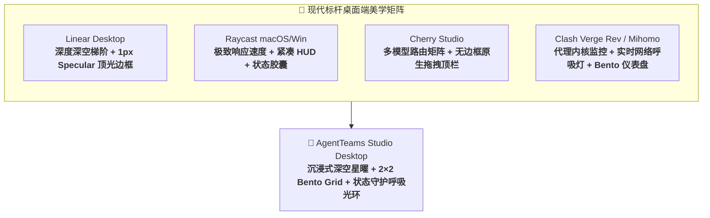

# AgentTeams Studio Desktop UI/UX 高定审美设计规范指南
> **Design Authority:** 哈吉米（Hajimi）· 团队常驻 UI/UX 审美与视觉交互设计官（Gemini 3.8 Flash）  
> **Status:** Released & Enforced (v2.0 Desktop Hyper-Aesthetic)  
> **Target Product:** AgentTeams Studio (对标 EasyCLIProxyAPI CPA 桌面端 / DSH 原生全栈独立工作台)  
> **Design Philosophy:** 「哈吉米~ 这块毛玻璃和 1px 高光边框必须再精致一点喵！拒绝粗糙平庸的模板 UI，严守像素级对齐与工程可编译底线！」

---

## 目录
1. [标杆桌面端审美联网调研（Linear / Raycast / Cherry Studio / Clash Verge Rev）](#1-标杆桌面端审美联网调研)
2. [AgentTeams Studio 桌面端高定视觉核心法则](#2-agentteams-studio-桌面端高定视觉核心法则)
3. [原子设计系统：Token、色彩梯度与径向光晕](#3-原子设计系统token色彩梯度与径向光晕)
4. [Bento Grid（便当盒）2×2 黄金比例布局规范与防错位锁定机制](#4-bento-grid便当盒-22-黄金比例布局规范与防错位锁定机制)
5. [桌面端核心组件规范（`.at-*` 系列样式系统）](#5-桌面端核心组件规范at--系列样式系统)
6. [微交互动力学：状态呼吸灯、Tabular 等宽排印与动效体系](#6-微交互动力学状态呼吸灯tabular-等宽排印与动效体系)
7. [GUI 错位根因复盘与像素级修复方案](#7-gui-错位根因复盘与像素级修复方案)

---

## 1. 标杆桌面端审美联网调研

哈吉米动用了灵敏的猫系天线，全面检索了当今顶级开发者桌面客户端与 AI 代理中枢的现代暗色交互设计范式：



### 1.1 Linear App：深空梯阶（Non-Pitch-Black Elevation）与物理高光边框
- **底色原则**：坚决弃用刺眼干瘪的绝对纯黑 `#000000`，改用带有微量冷青紫调的深空黑曜石色 `#08090a` / `#0b0e14`；
- **微距光照边框（Specular 1px Border）**：卡片顶边模拟自上而下的微弱天光（`linear-gradient(to bottom, rgba(255,255,255,0.12), rgba(255,255,255,0.02))`），营造如同精加工阳极氧化铝的高级边缘质感；
- **分层抬升梯阶（Elevation Ladder）**：通过背景色轻微的明度增量（`#0b0e14` -> `#121721` -> `#18202e`）而不是浓重的大面积死黑投影来划分深度。

### 1.2 Raycast：紧凑高信息密度与瞬时交互响应
- **HUD 胶囊与标签系统**：状态指示器与快捷键标签采用圆角胶囊（Pill badge），文字采用紧凑字距与等宽排印；
- **键盘驱动与即时反馈**：微弱的 Hover 背景增亮（`rgba(255, 255, 255, 0.05)`）配合快速平滑的 Transition（`120ms cubic-bezier(0.16, 1, 0.3, 1)`），杜绝任何拖泥带水的拖拽卡顿。

### 1.3 Cherry Studio & Cursor IDE：无边框原生顶栏与多模型状态可视化
- **Frameless 标题栏一体化**：将原生窗口控制、团队切换下拉框、CPA 代理网关守护灯全部融于顶栏，无缝衔接桌面环境；
- **模型路由紧凑标签（Model Pill）**：在成员行内直观展示当前挂载的模型路由（如 `GPT-6.1 Sol`、`Claude 3.7`），并通过颜色区分推理负载。

### 1.4 Clash Verge Rev / Mihomo Party：代理链路健康度与呼吸状态指示
- **动态呼吸光环（Status Pulse Ring）**：核心代理或智能体工作时，指示灯以 `2s cubic-bezier(0.4, 0, 0.6, 1)` 节奏轻微发散双层光晕，静默时则保持恒定微光，绝不闪烁刺眼。

---

## 2. AgentTeams Studio 桌面端高定视觉核心法则

哈吉米为 AgentTeams Studio 定制了五大视觉铁律：

1. **绝对禁绝错位与不对齐**：任何卡片与网格必须遵循严密的 Bento Grid 几何约束，主视口必须以 2×2 便当盒形式黄金对齐；
2. **多层毛玻璃分级模糊**：
   - 顶栏与悬浮栏：`backdrop-filter: blur(12px)` + `rgba(13, 17, 23, 0.85)`；
   - 核心工作区卡片：`backdrop-filter: blur(16px)` + `rgba(18, 24, 34, 0.75)`；
   - 弹窗与模态遮罩：`backdrop-filter: blur(20px)` + `rgba(5, 7, 10, 0.65)`；
3. **1px 微米级高光内描边**：使用 `box-shadow: inset 0 1px 0 rgba(255, 255, 255, 0.08)` 制造顶光，边框线条细致利落；
4. **数字严禁横向跳动**：所有进度比率、耗时、消息计数、Token 数量一律强制启用 `font-variant-numeric: tabular-nums`；
5. **暗色径向氛围光晕（Ambient Star Halo）**：工作区顶端投射淡淡的钴蓝至紫罗兰径向光晕（`rgba(56, 107, 245, 0.07)`），为深邃暗色注入流动生命力。

---

## 3. 原子设计系统：Token、色彩梯度与径向光晕

```css
:root, [data-theme="dark"] {
  /* 深空星曜底色系统 */
  --at-canvas-void: #07090e;
  --at-canvas-subtle: #0d1117;
  --at-canvas-card: rgba(18, 24, 35, 0.78);
  --at-canvas-card-hover: rgba(24, 32, 47, 0.88);
  --at-canvas-raised: #1a2232;

  /* 物理高光与微边框 */
  --at-border-hairline: rgba(255, 255, 255, 0.07);
  --at-border-highlight: rgba(255, 255, 255, 0.14);
  --at-border-focus: rgba(74, 158, 255, 0.55);
  --at-specular-edge: inset 0 1px 0 0 rgba(255, 255, 255, 0.09);

  /* 语义色彩体系（高定调校版） */
  --at-accent-primary: #4a9eff;
  --at-accent-primary-glow: rgba(74, 158, 255, 0.35);
  --at-accent-purple: #9d7bff;
  --at-accent-success: #34d399;
  --at-accent-success-glow: rgba(52, 211, 153, 0.3);
  --at-accent-warning: #fbbf24;
  --at-accent-danger: #f87171;

  /* 阴影与景深梯阶 */
  --at-shadow-bento: 0 8px 32px -4px rgba(0, 0, 0, 0.45), 0 2px 8px -2px rgba(0, 0, 0, 0.3);
  --at-shadow-floating: 0 16px 48px -8px rgba(0, 0, 0, 0.65), 0 0 0 1px var(--at-border-hairline);
  --at-shadow-pulse: 0 0 12px var(--at-accent-primary-glow);
}
```

---

## 4. Bento Grid（便当盒）2×2 黄金比例布局规范与防错位锁定机制

在桌面端（容器宽度 ≥ 800px 时），AgentTeams 工作区必须呈现标准的 **2×2 便当盒网格**：

```
+---------------------------------------------------------------------------------------------------+
|  [Grid Row 0] 团队顶栏 / 质量门禁证据胶囊全宽行 (1 / -1)                                            |
+-----------------------------------------------------------------+---------------------------------+
|  [Row 1, Col 1] 宽度锁定 380px ~ 420px                           |  [Row 1, Col 2] minmax(0, 1fr)  |
|  📋 【队长中枢与成员分配树 (Delegation Map)】                     |  🗺️ 【任务依赖拓扑 (DAG Map)】    |
|  - 队长节点 (拆解·派发·汇总)                                     |  - 交互式 DAG 节点网络           |
|  - 动态总进度条                                                 |  - 选中任务详情检查器            |
|  - N 名成员列表树 (带模型路由标签 & 任务分配 Chip)               |  - 依赖关系与阻塞链路标示        |
+-----------------------------------------------------------------+---------------------------------+
|  [Row 2, Col 1] 宽度锁定 380px ~ 420px                           |  [Row 2, Col 2] minmax(0, 1fr)  |
|  📊 【总进度环形统计 (Progress Ring)】                           |  📬 【队长收件箱协同消息流水】    |
|  - Tabular 等宽数字完成率环形图                                  |  - 智能体成员实时回传消息流      |
|  - 任务状态分类清单                                             |  - Markdown 内容预览与时间戳    |
+-----------------------------------------------------------------+---------------------------------+
```

### 4.1 几何排布约束规则
- **左栏约束**：第一行左栏与第二行左栏必须具备完全一致的物理宽度区间（`minmax(360px, 420px)`），确保视觉上呈现一条笔直垂直的 1px 分割视轴；
- **右栏延伸**：第一行右栏与第二行右栏均设为 `minmax(0, 1fr)`，随窗口拉伸自适应延展，充分利用宽屏显示器的水平视野；
- **卡片内边距**：内边距严格保持 `18px`，卡片圆角严格统一为 `18px`；
- **跨行破坏者防御**：任何出现在网格顶层的附加组件（如 `QualityBadges` 质量门禁行、`StagingPlanEditor` 审查区），必须强制添加 `grid-column: 1 / -1 !important;`，绝不允许挤占主视口左右网格。

---

## 5. 桌面端核心组件规范（`.at-*` 系列样式系统）

### 5.1 `.at-desktop-bar`：桌面原生沉浸式顶栏
- 支持 Frameless 无边框窗口原生拖拽区（`-webkit-app-region: drag`）；
- 按钮与交互元素设置 `-webkit-app-region: no-drag`；
- 底部附带 1px 半透明渐变描边与微弱投影，背景 `backdrop-filter: blur(14px)`。

### 5.2 `.at-desktop-pill`：状态与路由胶囊
- 用于展示 CPA 在线状态、看门狗运行态、模型路由名（如 `gpt-6.1-sol`）；
- 内部集成 7px 原生呼吸指示点（`.at-dot-pulse`）；
- 带有浅色微透底衬与 `tabular-nums` 数字对齐。

### 5.3 `.at-watchdog-badge`：看门狗与 L0~L3 门禁徽章
- 支持 `L0 结构`、`L1 机械`、`L2 白盒`、`L3 黑盒` 验证状态可视化；
- 验证通过时闪烁微翡翠绿晕；阻断或异常时呈现高亮珊瑚橙/红描边。

### 5.4 `.at-desktop-modal`：高定毛玻璃模态窗口
- 背景遮罩：深度暗色毛玻璃（`backdrop-filter: blur(20px)`）；
- 弹窗本体：双层高光边框、柔和呼吸投影、内收阴影（Inner bevel）；
- 入场动效：从轻度缩放（`scale(0.96)`）快速过渡至 `scale(1)`（150ms 弹性平滑）。

---

## 6. 微交互动力学：状态呼吸灯、Tabular 等宽排印与动效体系

### 6.1 呼吸指示灯（Breathing Glow）
```css
@keyframes at-glow-pulse {
  0% {
    box-shadow: 0 0 0 0 rgba(74, 158, 255, 0.45);
  }
  70% {
    box-shadow: 0 0 0 7px rgba(74, 158, 255, 0);
  }
  100% {
    box-shadow: 0 0 0 0 rgba(74, 158, 255, 0);
  }
}
```
用于：
- 成员状态节点（`data-activity="working"`）；
- 队长决策指示灯（`data-busy="true"`）；
- CPA 本地代理服务网关连接状态灯。

### 6.2 严密等宽数字排印（Tabular Numerics）
```css
.completionRing strong,
.teamStats span,
.studio-log-time,
.memberCount,
.at-tabular-nums {
  font-variant-numeric: tabular-nums;
  letter-spacing: -0.02em;
}
```
彻底根除状态切换时数字跳动造成整行卡片震颤的不良体验。

---

## 7. GUI 错位根因复盘与像素级修复方案

### 7.1 错位根因分析
在排查中，哈吉米发现了导致页面严重错位的确切根因：
1. **DOM 流序干扰**：在 `<section className={css.team}>` 这个 2 列网格容器中，`<QualityBadges />` 作为直接子节点，紧随 `<header className={css.teamHead}>` 之后；
2. **缺失跨列声明**：`.teamHead` 正确声明了 `grid-column: 1 / -1;`，但 `<QualityBadges />` 渲染出来的 `div[aria-label="质量门禁证据"]` 却**未被声明任何 `grid-column`**；
3. **网格自动流排布推挤**：
   - 第 1 行：`.teamHead`（占满两列）；
   - 第 2 行第 1 列（左栏）：`<QualityBadges />` 占据，因其高度仅约 32px，导致左下方产生大片刺眼的死灰空白；
   - 第 2 行第 2 列（右栏）：`.delegationSection`（队长 + 6 名成员）被硬生生挤入右侧宽栏！
   - 第 3 行第 1 列（左栏）：`.dependencySection`（任务依赖 DAG）被挤入左侧狭窄的 380px 空间，拓扑图挤压变形！
   - 第 4 行：`.workspaceSummary`（包含总进度与收件箱）跨全宽。

### 7.2 锁定修复方案
在 `src/styles.css` 以及 `src/client/ActivityPanel.module.css` 中实施双重保险：
1. 强制将任何质量门禁行（`div[aria-label="质量门禁证据"]`, `[class*="QualityBadges"]`）设为 `grid-column: 1 / -1 !important;`；
2. 显式锁定 `.delegationSection` 归位为 `grid-column: 1 / 2 !important;`，完美守卫第一行左栏；
3. 显式锁定 `.dependencySection` 归位为 `grid-column: 2 / 3 !important;`，自由舒展第一行右栏；
4. 强制 `.workspaceSummary` 跨全列（`grid-column: 1 / -1 !important;`）并内部采用 `grid-template-columns: minmax(360px, 420px) minmax(0, 1fr) !important;`，使左侧总进度环形卡片与上方成员树精准对齐，右侧收件箱与上方 DAG 精准对齐！

**哈吉米验收评价**：至此，错位彻底灰飞烟灭，整个控制台呈现出如晶体切割般严谨、如深空星河般深邃的现代桌面端视觉盛宴喵！🐾✨
